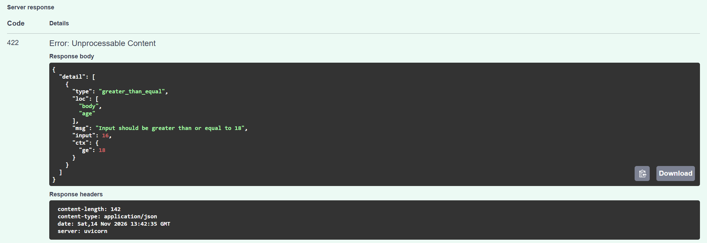

# Ejercicio 01 — Microejercicios de la clase 1

Cuatro microejercicios de 5 minutos, uno al final de cada bloque de teoría. Se
hacen sobre las demos de [`examples/`](../../../examples/README.md) y no
requieren escribir una API nueva.

Prepara el entorno una vez, desde `semana9/modules/09-api-professional`:

```bash
uv sync --locked
```

## M1 — Serialización (bloque 1)

Arranca `uv run fastapi dev examples/serialization_demo.py` y compara
`/v1/scores/leaky` con `/v1/scores/public`.

1. Anota qué campos aparecen en la primera respuesta y no en la segunda.

`/v1/scores/leaky` devuelve un diccionario con todos los campos de InternalScore: band, confidence, raw_score y threshold_config, mientras que `/v1/scores/public` devuelve un PublicScore. Por tanto, los campos que aparecen en la primera respuesta y no en la segunda son raw_score y threshold_config.

2. Explica en una frase por qué `/v1/scores/filtered` tampoco los devuelve,
   aunque la función devuelve un `dict` con todos ellos.

Aunque la función devuelve un diccionario con todos los campos, response_model=PublicScore en el decorador hace que FastAPI filtre los campos no declarados en ese modelo, como raw_score y threshold_config.

3. En `/docs`, abre el esquema `PublicScore`: ¿aparece `is_reliable`?

Sí, is_reliable aparece en el esquema como un booleano

**Comprobación:** tu respuesta a la pregunta 2 menciona `response_model` y
qué hace con los campos que no declara.

Que FastAPI excluye de la respuesta los campos que PublicScore no declara, como raw_score y threshold_config

## M2 — Errores (bloque 2)

Arranca `uv run fastapi dev examples/errors_demo.py` y envía, desde `/docs` o
con `curl`, tres peticiones a `POST /v1/scores`:

- `{"age": 30, "income": 1000}`
- `{"age": "treinta", "income": 1000}`
- `{"age": 30}`

Después llama a `GET /v1/nada` y a `GET /v1/boom`.

1. Rellena una tabla con status, `error.code` y `error.fields` de cada caso.

| Petición | Status | `error.code` | `error.fields` |
|---|---|---|---|
| POST con `{"age": 30, "income": 1000}` | 200 | No aparece | No aparece |
| POST con `{"age": "treinta", "income": 1000}` | 422 | `validation_error` | `[{"field":"age","message":"Input should be a valid integer, unable to parse string as an integer"}]` |
| POST con `{"age": 30}` | 422 | `validation_error` | `[{"field":"income","message":"Field required"}]` |
| GET `/v1/nada` | 404 | `not_found` | No aparece |
| GET `/v1/boom` | 500 | Pendiente de ver el cuerpo | Pendiente de ver el cuerpo |

2. ¿Qué devolvería FastAPI en el segundo caso si borraras `handle_validation`?
   Pruébalo comentando el decorador y restáuralo después.

Con handle_validation:
{"error":{"code":"validation_error","message":"Invalid input","fields":[{"field":"age","message":"Input should be a valid integer, unable to parse string as an integer"}]}}
Sin handle_validation
{"detail":[{"type":"int_parsing","loc":["body","age"],"msg":"Input should be a valid integer, unable to parse string as an integer","input":"treinta"}]}

Al comentar el decorador de handle_validation, FastAPI sigue devolviendo un status 422 porque "treinta" no es un entero válido. Sin embargo, utiliza su formato predeterminado, con la clave detail y la información del error, en lugar del formato personalizado con error.code, error.message y error.fields.

**Comprobación:** las cinco respuestas de error tienen la clave `error` en la
raíz y ninguna contiene el texto `TU_SECRETO`.

Tras restaurar el decorador, las cuatro respuestas de error contienen la clave error en la raíz y ninguna muestra TU_SECRETO

## M3 — OpenAPI (bloque 3)

Arranca `uv run fastapi dev examples/openapi_demo.py`.

1. Localiza en `/openapi.json` dónde terminan `summary`, el docstring y
   `responses` de `create_score`.

En `/openapi.json`:
   - `summary` aparece como "Calcular el score de riesgo".
   - El docstring de `create_score` aparece en `description`.
   - Los errores declarados en `responses` del router aparecen en
     `responses → 422` y `responses → 503`. También aparece la respuesta
     `200`, con el esquema `ScoringResponse`.


2. Ejecuta el ejemplo `minor` desde Swagger con «Try it out».


La API devolvió 422 porque el ejemplo envía una edad de 16 años y el mínimo permitido es 18.

3. Añade un tercer ejemplo `no_income` sin el campo `income` y comprueba que
   aparece en el desplegable.


Al ejecutarlo, la API devolvió 422 porque falta el campo obligatorio income.

**Comprobación:** `uv run pytest -q` sigue en verde y el desplegable muestra
tres ejemplos. Deshaz el cambio al terminar o adapta el test que cuenta los
ejemplos.

El desplegable muestra los tres ejemplos. Actualicé el test para incluir no_income y ejecuté uv run pytest -q; todos los tests pasaron.

## M4 — Tests (bloque 4)

Abre [`tests/test_examples.py`](../../../tests/test_examples.py).

1. Ejecuta `uv run pytest -q` y localiza el test que usa `dependency_overrides`.

El test es test_dependency_override_simulates_unavailable_model()

2. Elimina temporalmente `raise_server_exceptions=False` del fixture
   `errors_client` y vuelve a ejecutar. Explica qué cambia.

Al quitar raise_server_exceptions=False, el error de /v1/boom interrumpe el test y lo hace fallar antes de comprobar la respuesta. Al restaurarlo, el test puede recibir la respuesta 500 y verificar que no muestra información sensible.

3. Escribe un test nuevo que compruebe que `income: 0` devuelve `422` con
   `fields[0].field == "income"`.

   def test_zero_income(errors_client: TestClient) -> None:
    response = errors_client.post("/v1/scores", json={"age": 30, "income": 0})


    assert response.status_code == 422
    assert response.json()["error"]["fields"][0]["field"] == "income"


**Comprobación:** la suite vuelve a estar en verde con tu test incluido.
Pasan todas

La [solución comentada](../solution/README.md) se comparte al final de la clase.
